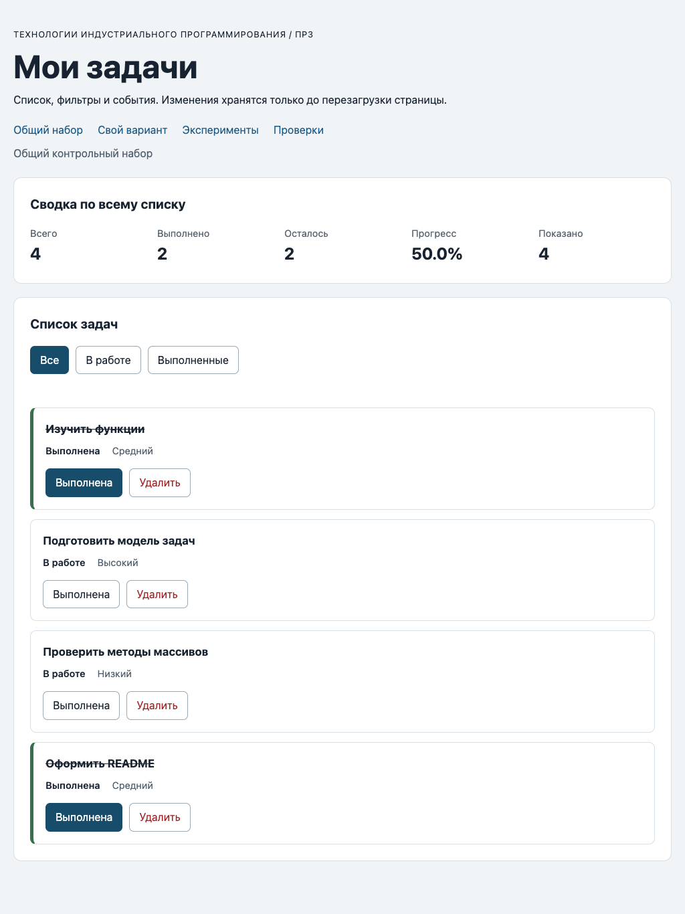

# Практическая работа № 3. Работа с DOM и событиями

## Данные работы

| Поле | Значение |
|---|---|
| Имя | Пунанов Егор |
| Группа | ЭФБО-06-25 |
| Вариант из ПР2 | 5 («Разработка командного прототипа») |
| Node.js | v26.8.2 |
| npm | 11.19.1 |
| Git | 2.50.1 (Apple Git-155) |
| Браузер | Safari 26.6 (ручная проверка); Chromium 152 (автоматический прогон `checks.html` и сценариев) |
| Операционная система | macOS 26.6 |

## Запуск

Рабочая папка: `practice-03` внутри личного репозитория.

```bash
npm run check:service
npm start
```

Устанавливать зависимости через `npm install` не требуется. Для PowerShell при блокировке `npm.ps1` доступны `npm.cmd` и прямые команды `node`.

```text
http://127.0.0.1:5503/
http://127.0.0.1:5503/index.html?dataset=variant
http://127.0.0.1:5503/examples/dom-events.html
http://127.0.0.1:5503/checks.html
```

Остановка сервера: `Ctrl+C`. Порт по умолчанию `5503` свободен, другой не использовался.

## Что перенесено из ПР2

`src/task-service.js` и `src/data.js` скопированы из `practice-02/src/` без изменений. В `data.js` заполнены `variantNumber = 5` и шесть задач `variantTasks` с `id` 11, 23, 37, 41, 58, 64 (первые четыре выполнены). Перед началом работы выполнен `npm run check:service` на копии внутри ПР3: 35 проверок пройдено, 0 ошибок (протокол ниже). Исправлений в функциях ПР2 не потребовалось. `main.js` из ПР2 не переносился: там был консольный сценарий.

## Эксперименты

Страница `examples/dom-events.html`. Прогнозы сделаны по исходному коду `dom-events.js`.

| № | До запуска: прогноз | После запуска: результат | Объяснение |
|---:|---|---|---|
| 1. Отсутствующий элемент и коллекция | `querySelector("#absent")` даст `null`, пустой `querySelectorAll` даст коллекцию длиной `0`. | `Отсутствующий элемент: null`; `Пустая коллекция: 0`. | `querySelector` при отсутствии совпадений возвращает `null`, а `querySelectorAll` всегда возвращает `NodeList`, пусть и пустой. Читать свойства у `null` нельзя, а у пустой коллекции можно (`length` равен `0`). |
| 2. dataset и числовой id | `dataset.taskId` — строка `"23"`, после `Number` — число `23`. | `dataset.taskId: 23 string`; `Числовой id: 23`. | `dataset` хранит все значения строками; число получается явным преобразованием `Number`. Для `"4abc"` вместо этого вышло бы `NaN`, поэтому в обработчике используется `Number`, а не `parseInt`. |
| 3. Статический NodeList | После двух нажатий сохранённый `initialItems` останется длиной `1`, новый запрос покажет `2`, затем `3`. | `Старый NodeList: 1` / `Новый querySelectorAll: 2` и `Старый NodeList: 1` / `Новый querySelectorAll: 3`. | `querySelectorAll` возвращает статический снимок на момент вызова. Новые узлы в него не попадают, нужен новый запрос. |
| 4. Строка с HTML-разметкой | В заголовке появится текст с угловыми скобками, дочерних элементов не будет. | Заголовок `<strong>Это текст, а не HTML</strong>`, число дочерних элементов у `h2` равно `0`. | `textContent` записывает значение как текст и не разбирает его как HTML. Поэтому названия задач безопасно выводятся через `textContent`, а `innerHTML` не используется. |
| 5. Распространение события | Нажатие по вложенному `span` пройдёт три обработчика: захват на карточке (фаза 1), всплытие на кнопке (фаза 3), всплытие на карточке (фаза 3). | `1. phase=1; target=lab-label; currentTarget=lab-card` / `2. phase=3; target=lab-label; currentTarget=lab-button` / `3. phase=3; target=lab-label; currentTarget=lab-card` | `event.target` всё время `span#lab-label` (исходная цель), а `event.currentTarget` меняется: это элемент, чей обработчик выполняется сейчас. Обработчик кнопки вызывается на фазе 3, потому что цель — вложенный `span`, а не сама кнопка. Поэтому обработчик контейнера получает нажатие на вложенный элемент и ищет кнопку через `closest`. |

## Организация кода

- `src/task-service.js` — функции ПР2 (проверки, поиск, сводка, добавление, изменение, удаление). Не знает про `document`, фильтры и кнопки.
- `src/task-selectors.js` — `getVisibleTasks(tasks, filter)`: возвращает новый массив для `all`, `pending`, `completed` (через `filter`), исходный порядок и объекты сохраняются.
- `src/task-view.js` — создание и обновление DOM: `createTaskElement`, `renderTaskList` (через `replaceChildren`, сам `ul` сохраняется), `renderSummary` (через `getTaskStats`), `renderEmptyState`. Все тексты назначаются через `textContent`, `innerHTML` не используется. Состояние не изменяется, обработчики не назначаются.
- `src/main.js` — состояние, события и связка модулей.

**Где хранятся данные:** полный список — в `currentTasks`, выбранный фильтр — в `currentFilter` (обе переменные в `main.js`). Видимая выборка рассчитывается заново в `renderApp()` и нигде не сохраняется, поэтому фильтр не удаляет данные.  
**Где обрабатывается событие:** два делегированных обработчика на контейнерах `#task-list` и `#task-filters`, подписки выполняются один раз при загрузке модуля. Кнопка ищется через `closest`, принадлежность контейнеру проверяется через `contains`.  
**Где вычисляется сводка:** в `getTaskStats` (`task-service.js`) по полному `currentTasks`. `renderSummary` только форматирует значения (`toFixed(1)` и `%`), а «Показано» — длина видимой выборки.

## Общий сценарий

Фактические результаты получены запуском приложения по адресу `http://127.0.0.1:5503/` в браузере (Chromium) с автоматическим выполнением тех же нажатий. Результат нажатий воспроизведите вручную и сверьте.

| Шаг | Видимые id | Всего | Выполнено | Осталось | Прогресс | Показано | Сообщение | Совпало с ожиданием |
|---:|---|---|---|---|---|---|---|---|
| 0 | `[1, 4, 7, 10]` | 4 | 2 | 2 | `50.0%` | 4 | — | Да |
| 1 | `[4, 7]` | 4 | 2 | 2 | `50.0%` | 2 | — | Да |
| 2 | `[7]` | 4 | 3 | 1 | `75.0%` | 1 | — | Да |
| 3 | `[1, 4, 7, 10]` | 4 | 3 | 1 | `75.0%` | 4 | — | Да |
| 4 | `[1, 4, 10]` | 3 | 3 | 0 | `100.0%` | 3 | — | Да |
| 5 | `[]` | 3 | 3 | 0 | `100.0%` | 0 | «Нет задач по выбранному фильтру.» | Да |
| 6 | `[1, 4, 10]` | 3 | 2 | 1 | `66.7%` | 3 | — | Да |
| 7 | `[]` | 0 | 0 | 0 | `0.0%` | 0 | «Список задач пуст.» | Да |

После перезагрузки: вернулось исходное состояние шага 0 (`[1, 4, 7, 10]`, 4 / 2 / 2 / `50.0%`, показано 4, фильтр «Все»). Это ожидаемо: сохранение данных в ПР3 не предусмотрено.

Одно нажатие на кнопку статуса выполняется однократно и после серии переключений фильтров: после `pending`, `all`, `completed`, `all`, `pending`, `all` и одного нажатия по `id = 4` итог `4 / 3 / 1 / 75.0%`.

## Индивидуальный вариант

**Тема:** «Разработка командного прототипа» (вариант 5). Страница: `http://127.0.0.1:5503/index.html?dataset=variant`, подпись «Индивидуальный вариант: 5».

| `id` | Название | Статус | Приоритет |
|---:|---|---|---|
| 11 | Согласовать требования к прототипу | выполнена | `medium` |
| 23 | Распределить роли в команде | выполнена | `high` |
| 37 | Собрать макет интерфейса | выполнена | `low` |
| 41 | Реализовать основной сценарий | выполнена | `medium` |
| 58 | Провести внутреннее тестирование | в работе | `high` |
| 64 | Подготовить демонстрацию прототипа | в работе | `low` |

| Этап | Всего | Выполнено | Осталось | Прогресс | Видимые id |
|---|---|---|---|---|---|
| До действий | 6 | 4 | 2 | `66.7%` | `[11, 23, 37, 41, 58, 64]` |
| После переключения 23 | 6 | 3 | 3 | `50.0%` | `[11, 23, 37, 41, 58, 64]` |
| После удаления 37 | 5 | 2 | 3 | `40.0%` | `[11, 23, 41, 58, 64]` |
| Итог, фильтр «В работе» | 5 | 2 | 3 | `40.0%` | `[23, 58, 64]` |
| Итог, фильтр «Выполненные» | 5 | 2 | 3 | `40.0%` | `[11, 41]` |

Итог совпадает с таблицей методички для варианта 5 (выполнено после двух действий — 2, прогресс `40.0%`). Фильтры до действий: «В работе» — `[58, 64]`, «Выполненные» — `[11, 23, 37, 41]`. После удаления остались `id` `[11, 23, 41, 58, 64]`.

## Протокол проверки сервиса

Вывод `npm run check:service`:

```text
OK: 01. Создание задачи с явным приоритетом
OK: 02. Приоритет по умолчанию
OK: 03. Удаление краевых пробелов без изменения внутренних
OK: 04. Граничные длины названия и положительный безопасный id
OK: 05. Некорректные названия при создании
OK: 06. Некорректные идентификаторы при создании
OK: 07. Все допустимые приоритеты и отклонение недопустимых
OK: 08. Каждый вызов createTask возвращает новый объект
OK: 09. Поиск по id, а не по индексу
OK: 10. Отсутствующая задача и пустой массив при поиске
OK: 11. Поиск не преобразует строковый id в число
OK: 12. Получение невыполненных задач
OK: 13. Пустой список, все выполнены и все не выполнены
OK: 14. Названия в исходном порядке и пустой список
OK: 15. Сводка по общему набору
OK: 16. Сводка по пустому списку
OK: 17. Сводка: ничего не выполнено и выполнено всё
OK: 18. Процент остаётся числом без предварительного округления
OK: 19. Добавление в конец без изменения входного массива
OK: 20. Добавление в пустой список с приоритетом по умолчанию
OK: 21. Повторяющийся id отклоняется
OK: 22. Добавление не обходит проверки createTask
OK: 23. Изменение completed в обе стороны
OK: 24. completed принимает только boolean
OK: 25. Некорректный или отсутствующий id при изменении статуса
OK: 26. Повторная установка статуса создаёт новый результат
OK: 27. Переименование сохраняет остальные поля
OK: 28. Проверки названия при переименовании
OK: 29. Некорректный или отсутствующий id при переименовании
OK: 30. Удаление по id с сохранением порядка
OK: 31. Удаление единственной записи
OK: 32. Некорректный, отсутствующий id и удаление из пустого списка
OK: 33. Входные объекты не изменяются ни одной операцией
OK: 34. Общий сценарий и все промежуточные сводки
OK: 35. Работа с другим набором, без зависимости от demoTasks

Проверок пройдено: 35; не пройдено: 0.
```

## Протокол браузерных проверок

Текст из блока «Текстовый протокол» на `checks.html`:

```text
OK: Фильтр all возвращает новый массив в исходном порядке
OK: Фильтр pending выбирает невыполненные задачи
OK: Фильтр completed выбирает выполненные задачи
OK: Все три фильтра работают с пустым списком
OK: Фильтрация не меняет входные записи и их порядок
OK: Карточка — li.task-card с числовым id в dataset
OK: Статус невыполненной карточки и aria-pressed согласованы
OK: Статус выполненной карточки и aria-pressed согласованы
OK: В карточке две обычные кнопки с вложенными подписями
OK: Все приоритеты отображаются по установленному словарю
OK: Название с разметкой отображается текстом
OK: Отрисовка списка создаёт карточки в исходном порядке
OK: Повторная отрисовка не накапливает карточки
OK: Контейнер списка и его обработчик сохраняются
OK: Отрисовка пустого массива очищает прежние карточки
OK: Сводка считается по всему списку, отдельно выводится Показано
OK: Пустая сводка не содержит NaN и Infinity
OK: Сообщение для полностью пустого списка
OK: Сообщение для пустого результата фильтра
OK: Появление карточек скрывает прежнее пустое состояние
OK: Приложение: начальный набор и сводка
OK: Приложение: фильтр срабатывает по клику на вложенный span
OK: Приложение: активный фильтр отмечен классом и aria-pressed
OK: Приложение: фильтрация не удаляет скрытые задачи
OK: Приложение: переключение по id, а не индексу массива
OK: Приложение: выполненная задача исчезает из фильтра В работе
OK: Приложение: удаление изменяет данные, а не только DOM
OK: Приложение: клик по названию не изменяет данные
OK: Приложение: после перерисовок одно нажатие — одно изменение
OK: Приложение: удаление всех записей и нулевая сводка
OK: Приложение: нет совпадений — не то же самое, что нет задач
OK: Приложение: неизвестный числовой id не меняет данные
OK: Приложение: id 4abc не превращается в 4
OK: Приложение: неизвестное действие игнорируется
OK: Приложение: после изменения сохраняется клавиатурный фокус
OK: Приложение: новая загрузка возвращает исходное состояние

Всего: 36. Пройдено: 36. Ошибок: 0.
```

## Собственные проверки

| № | Исходное состояние и действия | Ожидаемый результат | Фактический результат | Итог |
|---:|---|---|---|---|
| 1 (граничное состояние) | Общий набор. Удалить `id` 1, 4, 7 (остаётся один выполненный `id = 10`), затем выбрать «В работе», затем «Выполненные». | Одна задача: всего 1, выполнено 1, осталось 0, `100.0%`, показано 1. «В работе» — пустая выборка с сообщением «Нет задач по выбранному фильтру.» (список не пуст, сводка остаётся 1 / 1 / 0 / `100.0%`). «Выполненные» — снова `[10]`. | После удалений `[10]`, `1 / 1 / 0 / 100.0% / 1`. «В работе»: `[]`, `1 / 1 / 0 / 100.0% / 0`, сообщение «Нет задач по выбранному фильтру.». «Выполненные»: `[10]`, показано 1. | Пройдено |
| 2 (событие и повторная отрисовка) | Общий набор. Пять раз подряд нажать «Выполнена» у `id = 4`, затем фильтры «Выполненные», «Все», «В работе», затем нажать «Выполнена» у `id = 7`. | После каждого нажатия статус `id = 4` меняется ровно один раз: выполнено 3, 2, 3, 2, 3 (прогресс `75.0%`, `50.0%`, `75.0%`, `50.0%`, `75.0%`). В «В работе» видна только `id = 7` (`4 / 3 / 1 / 75.0% / 1`). После выполнения `id = 7` карточка исчезает: `[]`, `4 / 4 / 0 / 100.0% / 0`, сообщение фильтра. | Выполнено после нажатий: 3, 2, 3, 2, 3 (`75.0%`, `50.0%`, `75.0%`, `50.0%`, `75.0%`). В «В работе» `[7]`, `4 / 3 / 1 / 75.0% / 1`. После выполнения `id = 7`: `[]`, `4 / 4 / 0 / 100.0% / 0`, сообщение «Нет задач по выбранному фильтру.». | Пройдено |
| 3 (все одного статуса, исходные данные не изменились) | Вариант 5 (`?dataset=variant`). Выполнить `id` 58 и 64, затем выбрать «В работе»; затем из модуля `data.js` прочитать `demoTasks` и `variantTasks`. | Все шесть задач выполнены: `6 / 6 / 0 / 100.0% / 6`. «В работе» — `[]` с сообщением «Нет задач по выбранному фильтру.». Экспортированные наборы не изменились: в `demoTasks` статусы `1: true, 4: false, 7: false, 10: true`; в `variantTasks` `11, 23, 37, 41: true`, `58, 64: false`. | `6 / 6 / 0 / 100.0% / 6`; «В работе»: `[]`, сообщение «Нет задач по выбранному фильтру.». `demoTasks`: `1:true, 4:false, 7:false, 10:true`; `variantTasks`: `11:true, 23:true, 37:true, 41:true, 58:false, 64:false`. | Пройдено |

## Отладка и клавиатура

**Значения в обработчике** (нажатие по подписи кнопки «Выполнена» у `id = 4`, общий набор). Значения получены инструментированием: на `#task-list` временно добавлен обработчик, записывающий данные события. **Точку останова в DevTools необходимо поставить самостоятельно** на строку 58 `src/main.js` (`const id = Number(card.dataset.taskId);`) и сверить значения ниже со своими:

| Что | Значение |
|---|---|
| `event.target` | `span.action-label` (вложенная подпись кнопки) |
| `event.currentTarget` | `ul#task-list` (контейнер, на котором висит обработчик) |
| `dataset.taskId` до преобразования | `"4"`, тип `string` |
| числовой `id` | `4` |
| действие | `toggle` |
| найденная запись (`findTaskById`) | `{ id: 4, title: "Подготовить модель задач", completed: false, priority: "high" }` |
| вызов сервиса | `setTaskCompleted(currentTasks, 4, true)` → `{ ok: true, tasks: [новый массив из 4 записей] }`, новый объект только у `id = 4` |

**Вторая остановка** — строка 81 `src/main.js` (`currentTasks = result.tasks;`), то же нажатие:

| Что | Значение |
|---|---|
| `result.ok` | `true` |
| `result.tasks` | `[{id:1, completed:true}, {id:4, completed:true}, {id:7, completed:false}, {id:10, completed:true}]` (названия и приоритеты не изменились) |
| `result.tasks === currentTasks` | `false` — новый массив |
| совпадение объектов по ссылке со старым массивом | `id 1: true`, `id 4: false`, `id 7: true`, `id 10: true` — новый объект только у изменённой записи |

После этой строки вызываются `renderApp()` (карточки, сводка `4 / 3 / 1 / 75.0%`, пустое состояние, активный фильтр) и `restoreTaskFocus(4, "toggle")`. Путь события: клик по `span` → всплытие до `ul#task-list` → `handleTaskListClick` → `closest("button[data-action]")` → `closest("[data-task-id]")` → `Number` → `findTaskById` → `setTaskCompleted` → проверка `ok` → `currentTasks` → `renderApp`.

**Отказ при подмене `data-task-id` через панель Elements:**

| Подмена | Результат |
|---|---|
| `777` (карточка `id = 4`, действие «Выполнена») | Сообщение «Задача с id 777 не найдена.», данные не изменились: сводка `4 / 2 / 2 / 50.0%`. Выбор фильтра «Все» пересоздал карточки из массива (`[1, 4, 7, 10]`) и очистил сообщение. |
| `4abc` | Сообщение «Некорректный идентификатор задачи.», `Number("4abc")` даёт `NaN`, задача `4` не найдена по ошибке. Данные не изменились (`4 / 2 / 2 / 50.0%`); после выбора «Все» карточки снова корректны, сообщение очищено. |

**Клавиатура** (Tab, Enter, Space; общий набор, нажатия выполнялись с клавиатуры):

| Действие | Результат |
|---|---|
| Tab трижды от кнопки «Все» | Фокус на кнопке «Выполнена» первой карточки (`id = 1`). |
| Enter на кнопке «Выполнена» | Статус `id = 1` изменился; после перерисовки фокус остался на кнопке «Выполнена» той же карточки. |
| Space на той же кнопке | Статус изменился ещё раз; фокус на той же кнопке. |
| Tab → «Удалить», Enter | Карточка `id = 1` удалена; так как карточки больше нет, фокус перешёл на активный фильтр «Все» (`restoreTaskFocus`). |
| Фильтр «В работе», выполнить `id = 7` | Карточка исчезла из выборки; фокус на кнопке фильтра «В работе». |

## Вид приложения

Общий набор после загрузки (`http://127.0.0.1:5503/`):



## Дополнительное задание

Дополнительное задание не выполнялось.

## Вывод

В ПР2 функции работали с массивом без интерфейса, а в ПР3 к ним добавлен слой отображения: данные по-прежнему изменяются только через `setTaskCompleted` и `removeTask`, а DOM после каждого успешного изменения создаётся заново из массива (`renderApp`). Главное различие: изменение данных — это новый массив в `currentTasks`, а изменение DOM — лишь его отображение. Удаление `<li>` без обновления массива вернётся после следующей отрисовки. Полный список и фильтр хранятся отдельно, поэтому фильтрация никогда не удаляет записи, а сводка считается по всему списку. Нажатие по вложенной подписи кнопки даёт `event.target = span`, а не кнопку (эксперимент 5), поэтому действие ищется через `closest`; идентификатор из `dataset` — строка, поэтому преобразуется `Number` с проверкой, а не `parseInt`. Ошибок в функциях ПР2 при подключении интерфейса не обнаружено.
