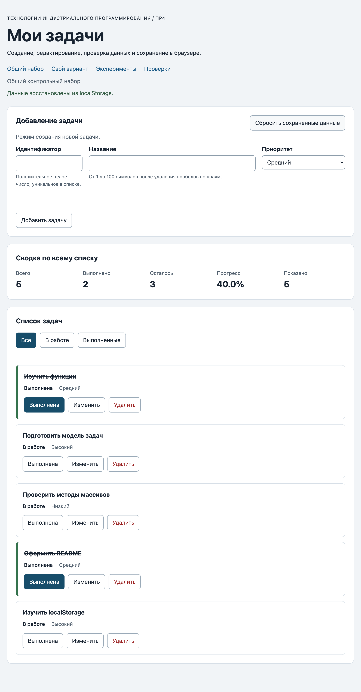

# Практическая работа № 4. Формы, валидация и локальное хранение данных

## Данные работы

| Поле | Значение |
|---|---|
| Имя | Пунанов Егор |
| Группа | ЭФБО-06-25 |
| Вариант из ПР2–ПР3 | 5 («Разработка командного прототипа») |
| Node.js | v26.8.2 (npm 11.19.1) |
| Браузер | Safari 26.6 (ручная проверка); Chromium 152 (прогон `checks.html` и сценариев) |
| Операционная система | macOS 26.6 |

## Запуск

Рабочая папка: `practice-04` внутри личного репозитория.

```bash
npm test
npm start
```

Устанавливать зависимости через `npm install` не требуется.

```text
http://127.0.0.1:5504/
http://127.0.0.1:5504/index.html?dataset=variant
http://127.0.0.1:5504/examples/forms-storage.html
http://127.0.0.1:5504/checks.html
```

Использовался порт по умолчанию `5504`.

## Перенос результата ПР3

Из `practice-03/src/` скопированы четыре модуля. До добавления `updateTask` выполнен `npm run check:service`: 35 проверок пройдено, 0 ошибок — исправлений в функциях ПР2–ПР3 не потребовалось.

| Файл | Что перенесено или изменено |
|---|---|
| `data.js` | Перенесён без изменений: общий `demoTasks` и вариант 5 (`variantTasks`, id 11, 23, 37, 41, 58, 64; первые четыре выполнены). |
| `task-service.js` | Перенесены девять функций ПР2. Добавлена `updateTask`: проверяет поля через `createTask`, наличие задачи через `findTaskById` и через `map` + spread меняет только `title` и `priority`, сохраняя `completed`. |
| `task-selectors.js` | Перенесён `getVisibleTasks` без изменений. |
| `task-view.js` | Перенесены функции отрисовки; в карточку добавлена третья кнопка `button[data-action="edit"]` с `span.action-label` «Изменить». Названия по-прежнему выводятся через `textContent`. |

## Эксперименты с формой и хранилищем

Страница `examples/forms-storage.html`.

| № | До запуска: прогноз | После запуска: результат | Объяснение |
|---:|---|---|---|
| 1. Пустое обязательное поле | Браузер не даст отправить форму, обработчик `submit` не вызовется. | Счётчик `submit` остался 0, журнал не изменился; `validity.valid = false`, `valueMissing = true`, сообщение «Заполните это поле.». | Нативная проверка `required` выполняется до события `submit`, поэтому обработчик просто не получает управление. |
| 2. Название из пробелов | `required` пропустит пробелы, сработает прикладная проверка. | `submit` вызван; журнал «submit получен, но прикладная проверка отклонила значение.»; `validity.customError = true`, `valid = false`. | Для `required` строка из пробелов непустая. Правило «не только пробелы» — прикладное: после `trim` длина 0, и через `setCustomValidity` поле помечается невалидным до следующего ввода. |
| 3. Типы значений `FormData` | Значение `title` — строка, `defaultPrevented = true`, название обрежется. | `submit.defaultPrevented: true`, `typeof FormData title: string`, `typeof localStorage value: string`; сохранено `{"title":"Форма","priority":"high"}` из ввода `"  Форма  "`. | `FormData` всегда возвращает строки, `preventDefault` отменил перезагрузку страницы, `trim` нормализовал название. |
| 4. Строка в `localStorage` и JSON | `getItem` вернёт строку JSON, `JSON.parse` восстановит объект. | «JSON прочитан успешно»: `raw` — строка `{"title":"Форма","priority":"high"}`, `parsed` — объект с теми же полями. | `localStorage` хранит только строки; объект нужно сериализовать `JSON.stringify` и разбирать `JSON.parse`. |
| 5. Повреждённый JSON | `JSON.parse` выбросит `SyntaxError`, страница не упадёт благодаря `try/catch`. | «JSON.parse завершился ошибкой: Expected property name or '}' in JSON at position 1», `raw = "{broken-json"`. | Строка в хранилище может быть любой, поэтому разбор обязательно оборачивается в `try/catch`, а результат затем проверяется по схеме. |

## Организация кода

- `task-service.js` — неизменяющие операции над массивом задач (ПР2 + `updateTask`). Не знает про DOM, форму и `localStorage`.
- `form-validation.js` — чистая функция `validateTaskDraft(draft, tasks, editingId)`: нормализует строковые значения формы, проверяет id (уникальность при создании, наличие при редактировании), название после `trim` и приоритет. Возвращает `{ ok, value }` или `{ ok: false, errors }` по полям. Не обращается к DOM.
- `task-storage.js` — граница хранилища: `isValidTaskList`, `loadTasks`, `saveTasks`, `removeSavedTasks`. JSON-оболочка `{ version: 1, tasks }`, все обращения к `storage` внутри `try/catch`.
- `task-view.js` — создание карточек, списка, сводки и пустого состояния.
- `main.js` — состояние (`currentTasks`, `currentFilter`, `editingId`), режим формы, обработчики `submit`, кликов по карточкам, фильтрам и сбросу; после успешной операции вызывает `saveTasks` через `persistCurrentTasks`.

Функции хранения получают `storage` аргументом: так видна внешняя зависимость и модуль проверяется в Node.js с объектом-имитацией (`MemoryStorage` в `checks/modules.checks.js`), а ошибки `getItem`/`setItem`/`removeItem` можно воспроизвести. Данные из JSON проверяются до использования, потому что успешный `JSON.parse` подтверждает только синтаксис: запись могла быть старой версии, вручную изменена или повреждена. Некорректная запись отклоняется целиком, приложение получает копию исходного набора и предупреждение.

## Проверка формы

| Сценарий | Ожидаемый результат | Фактический результат | Итог |
|---|---|---|---|
| Добавление корректной задачи | Задача `20` в конце списка, запись в storage | `[1, 4, 7, 10, 20]`, сообщение «Задача 20 добавлена.», в `tip-js-practice-04:demo` 5 задач | Пройдено |
| Повторяющийся id | Отказ без изменения списка | Ошибка у поля id «Задача с id 4 уже существует.», `aria-invalid="true"`, список и запись storage не изменились | Пройдено |
| Пустое название | Отказ | Нативная проверка `required` не пропустила отправку (проверено в `checks.html`, сценарий «Нативные ограничения не пропускают пустую форму») | Пройдено |
| Название из пробелов | Отказ прикладной проверки | «Название не должно состоять только из пробелов.», задача не добавлена | Пройдено |
| Название длиной 100 | Успех | Задача `21` добавлена, длина названия на карточке 100 | Пройдено |
| Название длиной 101 | Отказ | «Название должно быть не длиннее 100 символов.», ключ storage не создан (значение установлено программно, в обход `maxlength`) | Пройдено |
| Редактирование title и priority | Меняется одна задача, статус сохраняется | Задача 4 → «Подготовить форму задач», `low`, `completed: false` сохранён; у задачи 1 после редактирования `completed: true` сохранён (`checks.html`) | Пройдено |
| Отмена редактирования | Возврат к пустой форме создания | Поле id снова доступно и пустое, заголовок «Добавление задачи», кнопка «Добавить задачу», «Отменить» скрыта | Пройдено |

## Общий сценарий

Фактические результаты на `http://127.0.0.1:5504/` после нажатия «Сбросить сохранённые данные».

| Шаг | Действие | Видимые id | Всего | Выполнено | Осталось | Прогресс | Состояние storage |
|---:|---|---|---:|---:|---:|---:|---|
| 0 | Исходный запуск после сброса | `[1, 4, 7, 10]` | 4 | 2 | 2 | `50.0%` | ключа нет (`null`) |
| 1 | Добавление `id = 20` | `[1, 4, 7, 10, 20]` | 5 | 2 | 3 | `40.0%` | записано 5 задач |
| 2 | Отказ для повторного `id = 4` | `[1, 4, 7, 10, 20]` | 5 | 2 | 3 | `40.0%` | не изменилось (строка совпала) |
| 3 | Редактирование `id = 4` | `[1, 4, 7, 10, 20]` | 5 | 2 | 3 | `40.0%` | задача 4: «Подготовить форму задач», `low`, `completed: false` |
| 4 | Переключение `id = 7` | `[1, 4, 7, 10, 20]` | 5 | 3 | 2 | `60.0%` | задача 7 `completed: true` |
| 5 | Удаление `id = 1` | `[4, 7, 10, 20]` | 4 | 2 | 2 | `50.0%` | 4 задачи, версия 1 |
| 6 | Перезагрузка страницы | `[4, 7, 10, 20]` | 4 | 2 | 2 | `50.0%` | «Данные восстановлены из localStorage.» |
| 7 | Сброс данных | `[1, 4, 7, 10]` | 4 | 2 | 2 | `50.0%` | ключ отсутствует (`null`) |

Все значения совпали с таблицей методички.

## Проверка восстановления и ошибок

| Случай | Ожидание | Фактический результат | Итог |
|---|---|---|---|
| Записи нет | Используется независимая копия исходного набора | «Используется исходный набор; сохранённых данных пока нет.», `[1, 4, 7, 10]` | Пройдено |
| Корректная запись | Данные восстанавливаются после перезагрузки | Шаг 6 общего сценария: `[4, 7, 10, 20]`, «Данные восстановлены из localStorage.» | Пройдено |
| Повреждённый JSON | Приложение запускается с исходным набором и предупреждением | В ключ записано `{broken-json`; после перезагрузки `[1, 4, 7, 10]` и предупреждение «Не удалось прочитать сохранённые данные (Expected property name or '}' in JSON at position 1 …). Загружен исходный набор.», класс `is-warning`; запись не удалена до нажатия сброса | Пройдено |
| Неверная версия или схема | Исходный набор и предупреждение | `{"version":2,"tasks":[]}` → `[1, 4, 7, 10]` и «Сохранённые данные имеют неизвестную версию. Загружен исходный набор.» | Пройдено |
| Сброс | Удаляется только ключ текущего набора | После сброса `getItem("tip-js-practice-04:demo") === null`, ключ варианта не затронут; используется `removeItem`, а не `clear()` | Пройдено |
| Общий и индивидуальный наборы | Изменения не смешиваются | После изменений варианта ключ `demo` остался `null`, общий набор не изменился | Пройдено |

## Индивидуальный вариант

Исходные задачи варианта 5: 11 «Согласовать требования к прототипу» (выполнена, medium), 23 «Распределить роли в команде» (выполнена, high), 37 «Собрать макет интерфейса» (выполнена, low), 41 «Реализовать основной сценарий» (выполнена, medium), 58 «Провести внутреннее тестирование» (в работе, high), 64 «Подготовить демонстрацию прототипа» (в работе, low).

Добавлена задача 75 «Собрать отзывы команды о прототипе» (`medium`); задача 23 переименована в «Согласовать роли и зоны ответственности» с приоритетом `high` (статус `completed: true` сохранён); удалена задача 37.

| Этап | Всего | Выполнено | Осталось | Прогресс | Видимые id |
|---|---:|---:|---:|---:|---|
| Исходный набор | 6 | 4 | 2 | `66.7%` | `[11, 23, 37, 41, 58, 64]` |
| После добавления `75` | 7 | 4 | 3 | `57.1%` | `[11, 23, 37, 41, 58, 64, 75]` |
| После редактирования `23` | 7 | 4 | 3 | `57.1%` | `[11, 23, 37, 41, 58, 64, 75]` |
| После удаления `37` | 6 | 3 | 3 | `50.0%` | `[11, 23, 41, 58, 64, 75]` |
| После перезагрузки | 6 | 3 | 3 | `50.0%` | `[11, 23, 41, 58, 64, 75]` |
| После сброса | 6 | 4 | 2 | `66.7%` | `[11, 23, 37, 41, 58, 64]` |

Итог совпадает с таблицей методички для варианта 5: выполнено 3, прогресс `50.0%`. Общий набор при этом не изменился (ключ `demo` отсутствовал).

## Протокол проверок сервиса

Вывод `npm run check:service`:

```text
OK: 01. Создание задачи с явным приоритетом
OK: 02. Приоритет по умолчанию
OK: 03. Удаление краевых пробелов без изменения внутренних
OK: 04. Граничные длины названия и положительный безопасный id
OK: 05. Некорректные названия при создании
OK: 06. Некорректные идентификаторы при создании
OK: 07. Все допустимые приоритеты и отклонение недопустимых
OK: 08. Каждый вызов createTask возвращает новый объект
OK: 09. Поиск по id, а не по индексу
OK: 10. Отсутствующая задача и пустой массив при поиске
OK: 11. Поиск не преобразует строковый id в число
OK: 12. Получение невыполненных задач
OK: 13. Пустой список, все выполнены и все не выполнены
OK: 14. Названия в исходном порядке и пустой список
OK: 15. Сводка по общему набору
OK: 16. Сводка по пустому списку
OK: 17. Сводка: ничего не выполнено и выполнено всё
OK: 18. Процент остаётся числом без предварительного округления
OK: 19. Добавление в конец без изменения входного массива
OK: 20. Добавление в пустой список с приоритетом по умолчанию
OK: 21. Повторяющийся id отклоняется
OK: 22. Добавление не обходит проверки createTask
OK: 23. Изменение completed в обе стороны
OK: 24. completed принимает только boolean
OK: 25. Некорректный или отсутствующий id при изменении статуса
OK: 26. Повторная установка статуса создаёт новый результат
OK: 27. Переименование сохраняет остальные поля
OK: 28. Проверки названия при переименовании
OK: 29. Некорректный или отсутствующий id при переименовании
OK: 30. Удаление по id с сохранением порядка
OK: 31. Удаление единственной записи
OK: 32. Некорректный, отсутствующий id и удаление из пустого списка
OK: 33. Входные объекты не изменяются ни одной операцией
OK: 34. Общий сценарий и все промежуточные сводки
OK: 35. Работа с другим набором, без зависимости от demoTasks

Проверок пройдено: 35; не пройдено: 0.
```

## Протокол проверок новых модулей

Вывод `npm run check:modules`:

```text
OK: 01. updateTask изменяет название и приоритет выбранной задачи
OK: 02. updateTask нормализует название и сохраняет completed
OK: 03. updateTask не изменяет входной массив и объекты
OK: 04. updateTask отклоняет некорректный и отсутствующий id
OK: 05. updateTask отклоняет некорректные название и приоритет
OK: 06. Валидация создания нормализует поля
OK: 07. Валидация отклоняет некорректные id
OK: 08. Валидация отклоняет повторяющийся id при создании
OK: 09. Валидация проверяет название после trim
OK: 10. Валидация принимает только три приоритета
OK: 11. В режиме редактирования используется editingId
OK: 12. Редактирование отсутствующей задачи отклоняется
OK: 13. Валидация не изменяет draft и список
OK: 14. Проверка схемы принимает корректный список
OK: 15. Проверка схемы отклоняет неверную структуру
OK: 16. Отсутствующая запись возвращает независимую копию исходных данных
OK: 17. Корректная запись восстанавливается из хранилища
OK: 18. Повреждённый JSON приводит к безопасному fallback
OK: 19. Неизвестная версия приводит к безопасному fallback
OK: 20. Некорректные задачи из JSON не принимаются
OK: 21. Ошибка getItem перехватывается
OK: 22. Сохранение записывает версию и задачи
OK: 23. Некорректный список не записывается
OK: 24. Ошибка setItem перехватывается
OK: 25. Удаляется только переданный ключ
OK: 26. Ошибка removeItem перехватывается
OK: 27. Результат загрузки не разделяет объекты с fallback

Проверок пройдено: 27; не пройдено: 0.
```

## Протокол браузерных проверок

Текст из блока «Текстовый протокол» на `checks.html`:

```text
OK: Фильтры ПР3 сохраняют порядок и не изменяют вход
OK: Карточка содержит toggle, edit и delete
OK: Название задачи выводится как текст
OK: Повторная отрисовка списка не накапливает карточки
OK: Сводка использует полный список и отдельный visibleCount
OK: Пустые состояния различают список и фильтр
OK: Приложение запускается с исходным набором
OK: Корректная форма добавляет задачу и сохраняет данные
OK: Повторяющийся id отклоняется без записи
OK: Название из пробелов отклоняется прикладной проверкой
OK: Нативные ограничения не пропускают пустую форму
OK: Кнопка edit заполняет форму и блокирует id
OK: Редактирование меняет title и priority, сохраняя completed
OK: Отмена редактирования возвращает режим создания
OK: Успешная отправка очищает ошибки и форму
OK: Изменение статуса сохраняется
OK: Удаление сохраняется
OK: Фильтр не записывается, но сохраняется после изменения данных
OK: Перезагрузка восстанавливает сохранённые задачи
OK: Сброс удаляет ключ и восстанавливает исходный набор
OK: Повреждённый JSON не ломает запуск
OK: Некорректная схема из storage заменяется исходным набором
OK: Общий и индивидуальный наборы используют разные ключи

Всего: 23. Пройдено: 23. Ошибок: 0.
```

## Собственные проверки

| № | Исходное состояние и действия | Ожидаемый результат | Фактический результат | Итог |
|---:|---|---|---|---|
| 1 (граница формы) | Общий набор после сброса. Ввести id 21 и название из 101 символа «x» (значение задано программно, в обход `maxlength`), отправить; затем то же название из 100 символов. | 101 — отказ с ошибкой у поля названия, storage не создаётся; 100 — задача добавлена. | 101: «Название должно быть не длиннее 100 символов.», список `[1, 4, 7, 10]`, ключ `null`. 100: список `[1, 4, 7, 10, 21]`, длина названия на карточке 100. | Пройдено |
| 2 (восстановление после перезагрузки) | Вариант 5 после сброса: добавить 75, переименовать 23 (high), удалить 37, перезагрузить страницу. | После перезагрузки те же 6 задач, у 23 новое название, `high` и `completed: true`. | `[11, 23, 41, 58, 64, 75]`, `6 / 3 / 3 / 50.0%`, статус «Данные восстановлены из localStorage.», задача 23 `{"title":"Согласовать роли и зоны ответственности","completed":true,"priority":"high"}`. | Пройдено |
| 3 (повреждение хранилища) | В DevTools записать в `tip-js-practice-04:demo` значение `{"version":2,"tasks":[]}` (корректный JSON, чужая версия), перезагрузить, затем сбросить. | Исходный набор, предупреждение о версии, запись не удалена автоматически; после сброса ключ отсутствует. | `[1, 4, 7, 10]`, «Сохранённые данные имеют неизвестную версию. Загружен исходный набор.», `is-warning`; ключ сохранился до сброса, после сброса `null`. | Пройдено |

## Отладка и клавиатура

Точка останова — в `handleFormSubmit` (`src/main.js`) на строке вызова `validateTaskDraft`. Значения для отправки «20 / "  Изучить localStorage  " / high» на общем наборе:

| Что | Значение |
|---|---|
| сырой `draft` | `{ id: "20", title: "  Изучить localStorage  ", priority: "high" }` — все значения строки из `FormData` |
| результат `validateTaskDraft` | `{ ok: true, value: { id: 20, title: "Изучить localStorage", priority: "high" } }` |
| результат `addTask` | `{ ok: true, tasks: [1, 4, 7, 10, 20] }`, новая запись `{ id: 20, title: "Изучить localStorage", completed: false, priority: "high" }` |
| записанная строка JSON | `{"version":1,"tasks":[…,{"id":20,"title":"Изучить localStorage","completed":false,"priority":"high"}]}` |

Ошибочный сценарий повторного id: `draft = { id: "4", title: "Дубликат", priority: "low" }` → `{ ok: false, errors: { id: "Задача с id 4 уже существует." } }`; `addTask` не вызывается, `currentTasks` и `localStorage` не меняются, ошибка показывается у поля id через `showFormErrors`.

Клавиатура: форма отправляется клавишей Enter в поле названия (обрабатывается `submit`). Tab переводит фокус по полям формы, затем по фильтрам и кнопкам карточек; Enter и Space на кнопках карточки выполняют действие. «Изменить» переводит фокус в поле названия (id заблокирован), «Отменить редактирование» и успешное сохранение возвращают фокус в поле id. После `toggle` фокус остаётся на той же кнопке, после `delete` — на активном фильтре (`restoreTaskFocus`).

## Вид приложения

Общий набор после добавления задачи 20 и перезагрузки страницы:



## Дополнительное задание

Не выполнено.

## Вывод

К интерфейсу ПР3 добавлены форма создания и редактирования, проверка ввода и сохранение в `localStorage`; логика ПР2–ПР3 перенесена без исправлений и расширена `updateTask`. В работе три разных уровня проверки: нативная HTML-проверка (`required`, `min`, `maxlength`) останавливает явно неполную форму ещё до `submit`; прикладная `validateTaskDraft` проверяет правила модели, которых HTML не знает (пробелы, уникальность id, существование редактируемой задачи), и сервис ещё раз защищает операцию; проверка после чтения хранилища (`loadTasks` + `isValidTaskList`) не доверяет даже синтаксически верному JSON и при любой проблеме откатывается к исходному набору с предупреждением.
