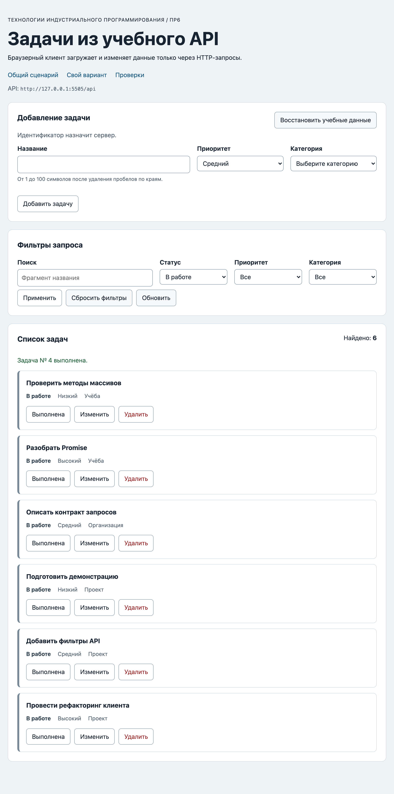

# Отчёт по практической работе № 6

**Тема:** Подключение браузерного приложения к API<br>
**Автор:** Пунанов Егор<br>
**Группа:** ЭФБО-06-25<br>
**Вариант:** 5

## 1. Цель работы

Подключить браузерный интерфейс задач к учебному HTTP API: читать, создавать, изменять и удалять задачи только через запросы, различать состояния загрузки и ошибки, защищаться от устаревших ответов. Результат — приложение, у которого источник истины — сервер, а после каждой изменяющей операции список заново запрашивается с текущими фильтрами.

## 2. Запуск

**Версии:**

```text
node --version: v26.8.2
npm --version:  11.19.1
```

**Команда запуска:**

```bash
npm start
```

**Адрес приложения:** `http://127.0.0.1:5506/`<br>
**Адрес API:** `http://127.0.0.1:5505/api`

Для ручной проверки «API не запущен» приложение открывалось с параметром `?api=http://127.0.0.1:5590/api`, а второй экземпляр API запускался командой `node api/server.mjs 5590`.

## 3. Реализация

### 3.1. HTTP-клиент

Решение ПР5 перенесено в `src/api-client.js` и расширено параметрами `method` и `body`. Разрешены `GET`, `POST`, `PATCH`, `DELETE` (метод приводится к верхнему регистру, иначе `TypeError`); `GET` с телом отклоняется до сетевого запроса. `Accept: application/json` добавляется всегда, `Content-Type: application/json` и `JSON.stringify(body)` — только при наличии тела. Сохранены тайм-аут (`AbortSignal.timeout`), объединение с внешним сигналом (`AbortSignal.any`) и виды ошибок `http`, `network`, `invalid-response`, `timeout`, `aborted`. HTTP-ошибка обрабатывается до проверки `Content-Type`, успешный `204` возвращает `null` без чтения тела.

### 3.2. Доменный API

`src/task-api.js`: `getTasks`, `getTaskById`, `getCategories`, `loadInitialData` (параллельно через `Promise.all`), `createTask` (POST `/tasks`, тело только `title`, `priority`, `categoryId`), `updateTask` и `setTaskCompleted` (PATCH `/tasks/:id`), `deleteTask` (DELETE, ожидается строго `null`), `resetDemoData` (POST `/debug/reset` без тела). Каждый метод принимает `{ signal }`. Схема ответа проверяется здесь же: `isTask`/`isCategory`, уникальность id, совпадение `meta.total` с длиной `data`, подтверждение `reset: true`; нарушение — `ApiError` с `kind: "invalid-response"`.

### 3.3. Состояния интерфейса

Каждая загрузка начинается с `setListState("loading")` (`aria-busy="true"`). После ответа: непустой список — `ready`, пустой — `empty` («По выбранным условиям задач нет.»), ошибка — `error` с текстом из `messageForError` и кнопкой повтора. Если категории ещё не загружены (начальная загрузка не удалась), повтор снова вызывает `loadInitialData`; иначе — `getTasks` с текущими фильтрами.

### 3.4. Изменение данных

Создание, редактирование, смена статуса, удаление и сброс выполняются через общую внутреннюю функцию `runMutation`: `setMutationPending(true)` → запрос → уведомление об успехе → повторный `GET /tasks` с текущими фильтрами → `setMutationPending(false)` в `finally`. При ошибке показывается сообщение, блокировка снимается; ошибка серверной валидации (`VALIDATION_ERROR` с `details`) дополнительно выводится у полей формы. Новый статус для `toggleTask` вычисляется из последнего ответа сервера. Неверная форма отклоняется `validateTaskDraft` без запроса.

### 3.5. Защита от устаревшего ответа

Перед каждой загрузкой предыдущий `AbortController` отменяется, и загрузке присваивается номер `loadSeq`. Результат применяется только если номер совпадает с последним — это защищает и в случае, когда источник не отреагировал на отмену. Ошибка `aborted` пользователю не показывается: это ожидаемое управление потоком.

## 4. Индивидуальный вариант

**Начальный фильтр:** `categoryId=1`<br>
**Индивидуальный сценарий:** перенести задачу в категорию 2; после обновления она исчезает из выборки.

После восстановления учебных данных открыта страница `/?dataset=variant`: фильтр «Категория» = «Учёба», запрос `GET /api/tasks?categoryId=1`, видимые id `[1, 7, 13]`, «Найдено: 3». У задачи 7 «Проверить методы массивов» нажато «Изменить», в форме подставлена категория 1; выбрана категория «Проект» (2) и форма отправлена. Ожидание: `PATCH /api/tasks/7` и повторный GET, задача 7 исчезает. Фактически: сообщение «Задача № 7 изменена.», видимые id `[1, 13]`, «Найдено: 2»; на сервере `GET /api/tasks/7` вернул `categoryId: 2`, статус `completed: false` не изменился.

## 5. Результаты проверок

### 5.1. Автоматизированные проверки Node.js

```text
Итог API: успешно 23, ошибок 0.
Итог модулей: успешно 33, ошибок 0.
Итог интеграции: успешно 14, ошибок 0.
```

### 5.2. Браузерные проверки

```text
OK: Карточка содержит безопасный текст и три действия
OK: Повторная отрисовка списка не накапливает карточки
OK: Начальная загрузка показывает 12 задач и 3 категории
OK: Фильтры формируют новый серверный запрос
OK: Поиск без результатов показывает empty, а сброс возвращает список
FAIL: Корректная форма создаёт задачу с серверным id — Не найден элемент: [data-task-id="35"]
FAIL: Ошибки формы не отправляют запрос и связаны с полями — Значения отличаются: получено 13, ожидалось 12
OK: Редактирование заполняет форму и сохраняет изменения
OK: Отмена редактирования возвращает режим создания
OK: Смена статуса подтверждается сервером
OK: Удаление подтверждается и сохраняется на сервере
OK: Сброс восстанавливает учебный набор
OK: Недоступный API показывает error и кнопку повтора
OK: Приложение не использует localStorage как источник данных

Всего: 14. Пройдено: 12. Ошибок: 2.
```

Два FAIL вызваны дефектом самой проверки, а не приложения. В сценарии «Корректная форма создаёт задачу с серверным id» условие `waitFor(() => requireNode(doc, '[data-task-id="35"]'))` выбрасывает исключение при первом же вызове, потому что `requireNode` не возвращает `null`, а сразу бросает ошибку, и `waitFor` её не перехватывает. Карточка появляется только после ответа сервера, поэтому синхронно её ещё нет. Второй FAIL — следствие первого: POST из первого сценария доходит до сервера уже после сброса во втором, и задач становится 13. Файлы проверок не изменялись. Оба сценария проверены вручную тем же способом, но с ожиданием ответа: задача 35 «Подключить браузер» появляется, форма очищается, «Найдено: 13»; форма с названием из пробелов показывает ошибку у поля (`aria-invalid="true"`), видимых задач по-прежнему 12, новых сетевых запросов 0.

### 5.3. Ручные проверки

| Сценарий | Ожидаемый результат | Фактический результат |
|---|---|---|
| API не запущен | Состояние ошибки и кнопка повтора | `error`: «Нет соединения с учебным API. Проверьте, запущен ли npm start.», кнопка «Повторить» видна, список скрыт. После запуска API и нажатия «Повторить» — `ready`, 12 задач, 3 категории, кнопка скрыта. |
| Пустая выборка | Сообщение empty, список без старых карточек | Поиск «несуществующая»: `empty`, «По выбранным условиям задач нет.», 0 карточек, «Найдено: 0». |
| Двойное быстрое применение фильтров | Отображается результат последнего запроса | `priority=low`, сразу `priority=high`: показаны `[4, 13, 16, 25, 34]` (high), состояние `ready`, ошибка отмены не показана. |
| Ошибка формы | Запрос не отправляется, поля получают сообщения | Название из пробелов: «Название не должно состоять только из пробелов.», `aria-invalid="true"`, 0 новых запросов. |
| Создание и обновление страницы | Созданная задача остаётся на сервере | Задача 35 «Проверить подключение к API» (Средний, Организация), «Найдено: 13»; после перезагрузки страницы задача 35 на месте. |
| Перезапуск API | Восстанавливается исходный набор | После перезапуска API `GET /tasks`: 12 задач, задачи 35 нет — данные хранятся только в памяти процесса. |
| Смена статуса при активном фильтре | `PATCH`, затем GET с тем же фильтром | Фильтр «В работе»: `[4, 7, 13, 19, 22, 28, 34]`; «Выполнена» у задачи 4 → `PATCH /api/tasks/4` (200), `GET /api/tasks?completed=false` (200), видимые `[7, 13, 19, 22, 28, 34]`, «Найдено: 6». |



## 6. Ответы на контрольные вопросы

1. _Почему `fetch` не отклоняет Promise при ответе 404?_
   Ответ 404 — это успешно полученный HTTP-ответ: соединение состоялось, сервер прислал статус и тело. `fetch` отклоняет Promise только когда ответа нет (сеть, CORS, отмена), поэтому статус проверяется явно через `response.ok`.
2. _Почему ответ 204 нельзя разбирать вызовом `response.json()`?_
   У 204 No Content нет тела; `response.json()` попытается разобрать пустую строку и выбросит `SyntaxError`. Поэтому клиент возвращает `null` до чтения тела.
3. _Чем состояние `empty` отличается от `error`?_
   `empty` — запрос выполнен успешно, но подходящих задач нет; это нормальный результат фильтра. `error` — данные получить не удалось, нужна повторная попытка.
4. _Зачем отменять предыдущий запрос при смене фильтров?_
   Иначе более ранний и более медленный ответ может прийти позже и перезаписать список для нового фильтра. Отмена экономит работу, а проверка номера загрузки гарантирует, что применится только последний результат.
5. _Почему после мутации список повторно запрашивается у API?_
   Источник истины — сервер: он назначает id, проверяет данные и применяет фильтры. Повторный GET с текущими фильтрами показывает только подтверждённое состояние, например исчезновение задачи из выборки после смены статуса или категории.

## 7. Вывод

Интерфейс (`dom-app.js`) только отображает состояние и передаёт события, контроллер (`app-controller.js`) управляет сценариями, загрузками и блокировкой, а все HTTP-операции идут через `task-api.js` и общий `api-client.js` по контракту API. Node.js-проверки проходят полностью (23 + 33 + 14). В браузерном прогоне 12 из 14: два сценария падают из-за дефекта готовой проверки (`requireNode` внутри `waitFor`), а то же поведение подтверждено вручную. Найденная при выполнении ошибка окружения: API ПР5 и ПР6 используют один порт 5505, поэтому перед запуском ПР6 API ПР5 нужно останавливать.
